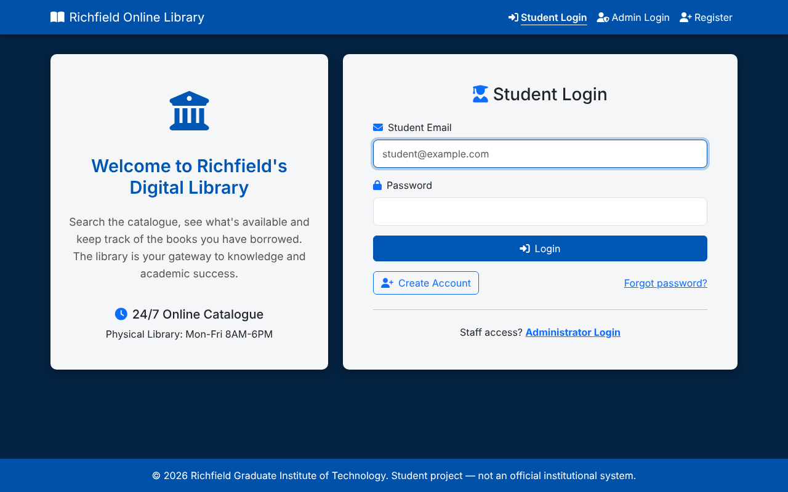
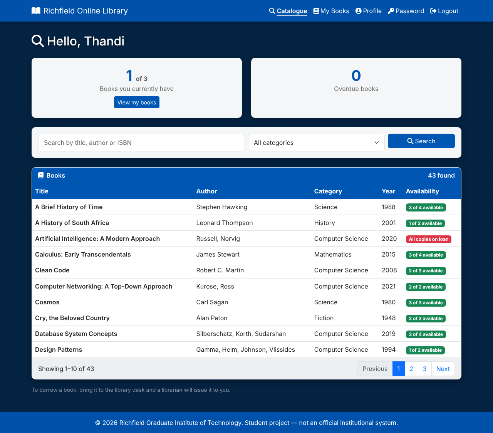
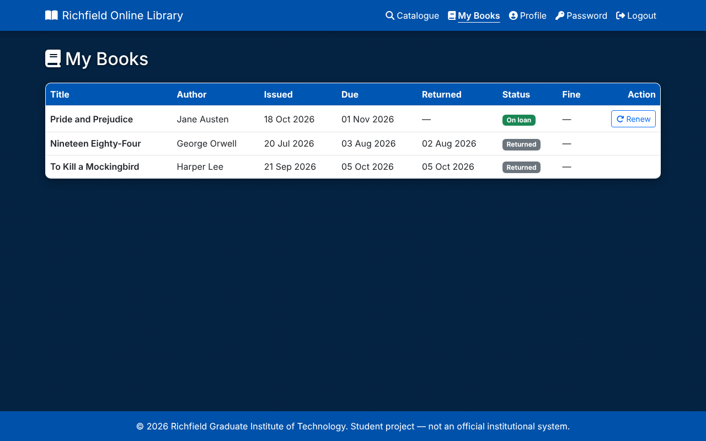
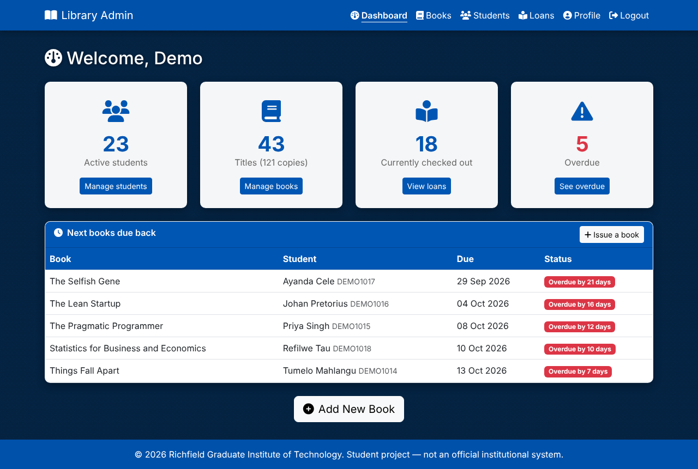
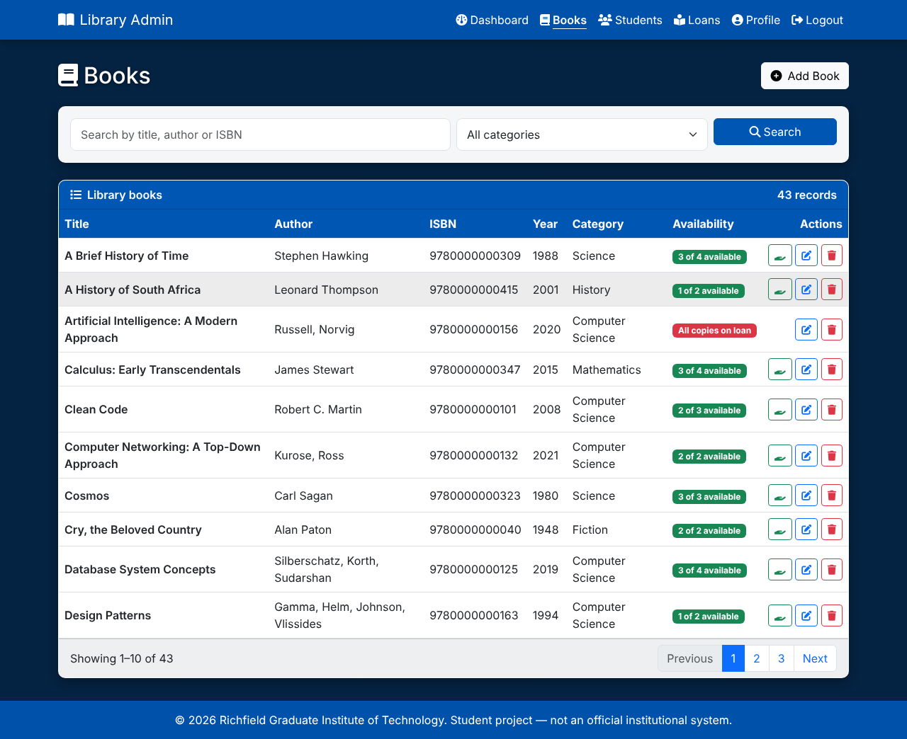
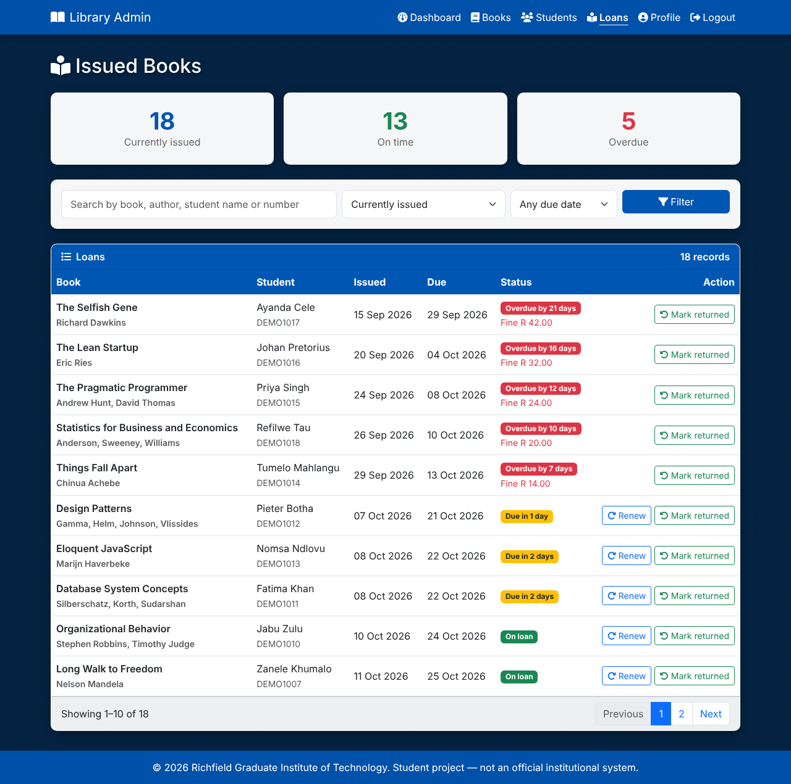

# Library Management System

A web-based library management system originally developed as a college project. Students can search the book catalogue and view their loans, while librarians can manage books and students, issue and return books, and review overdue loans. Built with PHP, SQL and Bootstrap 5.

This portfolio version improves the original front-end prototype with a database-backed application, authentication, lending rules and automated tests. **All demonstration data is fictitious.** This is a student project, not an official system of any institution, and it is not presented as a hosted production service.

## Screenshots

The images below are visual previews rendered from the project's page templates with fictitious display data. The database-backed application should be run locally to verify behaviour; these previews are for showing the interface in this repository.

| Student login | Student catalogue |
| --- | --- |
|  |  |

| Student loans | Administrator dashboard |
| --- | --- |
|  |  |

| Manage books | Issued books and overdue loans |
| --- | --- |
|  |  |

An additional administrator login preview is available at [`screenshots/admin-login.png`](screenshots/admin-login.png).

## Features

### Students
- Register, log in and log out.
- Search the catalogue by title, author or ISBN, filter by category, and view availability.
- View current and past loans, due dates, overdue warnings and late fines.
- Renew a loan once by default, provided it is not overdue.
- Edit a profile and change a password.

### Librarians / administrators
- View dashboard counts for students, titles and copies, books on loan, and overdue loans.
- Add, edit, search and delete books, including copy counts.
- Add students, deactivate or reactivate accounts, and reset passwords with a temporary password shown once.
- Issue books, renew loans and mark books as returned.
- Filter loan records by overdue status and due dates, with fines shown on late loans.

### Lending rules
Rules are configurable in `src/config.php`:
- Loans last 14 days.
- Students may have up to 3 books at a time.
- Each loan can be renewed once for another 14 days.
- Overdue loans cannot be renewed; the default late fine is R 2.00 per day per book (`fine_per_day` can be set to `0` to hide fines).
- A student cannot borrow another copy of the same title or borrow when no copies are available.
- Students with overdue books cannot borrow more until the books are returned.
- Books or students with loan history cannot be deleted; student accounts can be deactivated instead.

## Quick start on Windows (PowerShell)

Requirements: PHP 8.1 or newer with the `pdo_sqlite` extension enabled. SQLite is created automatically by the application setup.

From the project root, run:

```powershell
php database/seed.php --fresh
$env:LIB_ADMIN_KEY = "choose-a-secret"
php -S localhost:8000 -t public
```

Then open <http://localhost:8000> in your browser. Keep the terminal open while using the application.

`LIB_ADMIN_KEY` is the secret required on the administrator-registration page. If it is not set, administrator self-registration is disabled.

### Quick start on macOS / Linux (Bash)

```bash
php database/seed.php --fresh
export LIB_ADMIN_KEY="choose-a-secret"
php -S localhost:8000 -t public
```

### Demonstration accounts

The seed script creates fictitious local demo accounts:

| Role | Email | Password |
| --- | --- | --- |
| Administrator | `admin@example.com` | `Library#Admin2026` |
| Student | `thandi.nkosi@example.com` | `Student2026` |

All seeded student accounts use `Student2026`. These credentials are for local demonstration only. Do not reuse them for real accounts or deploy seeded demo credentials to a live system.

## Using MySQL / MariaDB

Create a database:

```sql
CREATE DATABASE lms CHARACTER SET utf8mb4 COLLATE utf8mb4_unicode_ci;
```

Import `database/schema.mysql.sql`, then configure the application and start the server. In Bash, an example is:

```bash
export LIB_DB_DRIVER=mysql
export LIB_DB_HOST=127.0.0.1
export LIB_DB_NAME=lms
export LIB_DB_USER=your_user
export LIB_DB_PASS=your_password
php -S localhost:8000 -t public
```

The seed script supports MySQL on an empty database. **The automated tests and manual walkthrough have been run with SQLite; the MySQL schema and driver path have not yet been verified against a live MySQL server.**

Settings can also be placed in `src/config.local.php` (ignored by Git), which returns an array of overrides. `LIB_APP_NAME`, `LIB_INSTITUTION` and `LIB_TIMEZONE` environment variables change the name shown in the header/footer and the timezone.

If a MySQL database was created before renewals were added, run `database/migrations/001_add_renewals.mysql.sql` once. SQLite databases are upgraded automatically.

## Automated tests

Run the tests locally from the project root:

```bash
php tests/run.php
```

The suite contains 73 checks covering validation, registration, login lockout, SQL-injection attempts, search, lending rules, renewals and fines, returns, password changes, input hardening and output escaping. Tests use a temporary in-memory SQLite database and do not use your saved library database.

### GitHub Actions workflow

The workflow at `.github/workflows/tests.yml` runs on pushes and pull requests. It sets up PHP 8.3 with `pdo_sqlite`, checks PHP syntax in `src/`, `public/`, `database/` and `tests/`, then runs `php tests/run.php`. It reports whether those checks pass; it does not deploy or host the PHP application.

## Security notes

- Database access uses prepared statements.
- Passwords are hashed using `password_hash` (bcrypt).
- Forms that change data include CSRF tokens; logout uses a POST request.
- Sessions use `HttpOnly` and `SameSite=Lax` cookies and are regenerated at login.
- Failed logins are rate-limited, and error messages avoid revealing whether an email is registered.
- Unexpected errors are logged rather than displayed to visitors; URL array parameters and excessive page numbers are rejected.
- Output is HTML-escaped; student and administrator access are separated; deactivating a student prevents them from logging in.
- Only `public/` should be exposed as the web root; `src/` and `database/` should remain outside it.
- A real deployment would need HTTPS and a fuller operational security review.

## Project layout

```text
public/                  Web root, PHP pages and CSS/JavaScript assets
src/                     Configuration, database, auth, CSRF, library rules and shared layout
database/                SQLite/MySQL schemas, seed data and migrations
tests/                   Automated test suite
screenshots/              Visual previews for the README
.github/workflows/        GitHub Actions test workflow
README.md                 Project overview and setup guide
```

Page names follow the original college project where practical. `index.php` is the student login; other main pages include `user_dashboard.php`, `my_books.php`, `admin_dashboard.php`, `manage_books.php`, `manage_users.php`, `admin_view_issued_books.php` and `issue_book.php`.

## What changed from the original prototype

- Added database-backed sessions and login flows.
- Implemented pages that were originally static mock-ups or missing links, including the student dashboard, logout, profile and password-recovery flow.
- Connected dashboard totals and tables to database data rather than hard-coded values.
- Consolidated duplicate sign-up pages and shared page layout and styling.
- Corrected the book form to use separate title, author, ISBN, year, category and copy-count fields.
- Replaced external placeholder avatars with initials.

## Known limitations

- Books are issued by a librarian at the desk; students cannot reserve books online.
- Fines are displayed only; there is no payment or fine-clearing workflow.
- There are no email notifications or book covers.
- Password recovery is handled by a librarian providing a temporary password because the project does not send email.
- Bootstrap and Font Awesome load from public CDNs, so an internet connection is needed for the full styling and icons.
- MySQL support is documented but has not yet been verified against a live MySQL server.

## Licence

This repository currently includes the MIT licence. See [LICENSE](LICENSE).
